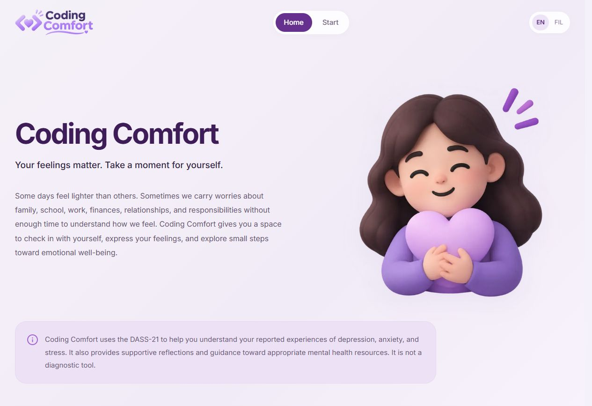
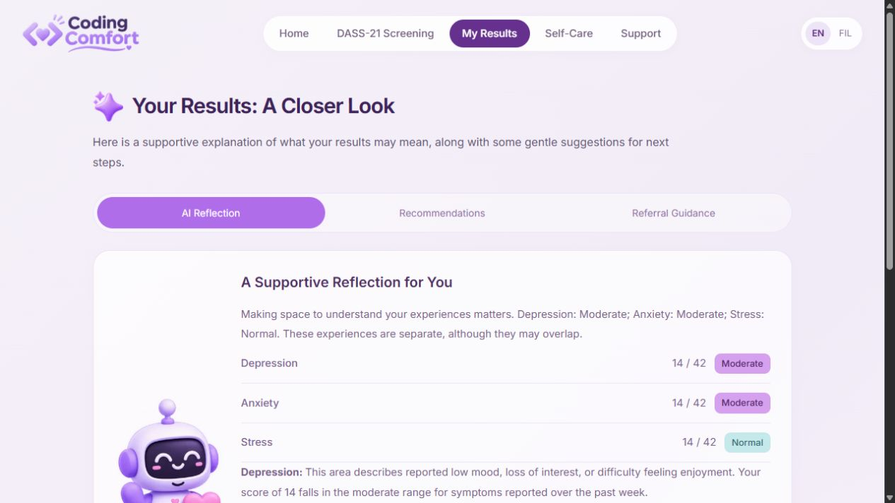
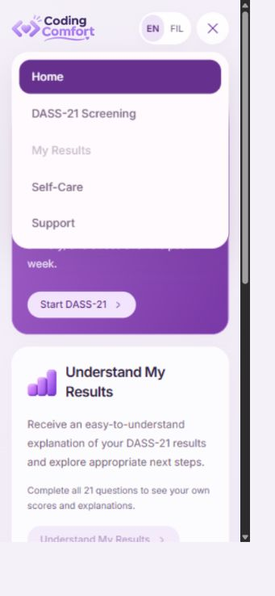

# Coding Comfort

English/Filipino DASS-21 screening, supportive explanations, self-care, and a protected researcher area. Participants do not need accounts. This is a research prototype, not a diagnosis or emergency service.

## Preview





## Run locally

```sh
npm ci
npm run dev
```

Copy `.env.example` to `.env.local` for a new checkout. On this configured workstation, preserve the existing ignored `.env.local`; it contains the server gate secret. Never commit it.

## Deploy the frontend to Vercel

Import `rcconstante/coding-comfort`, choose **Next.js**, root directory `.`, install `npm ci`, build `npm run build`. Keep the default Next.js output setting. Configure these environment variables before building:

| Vercel variable               | Production value                                                                                                                                             |
| ----------------------------- | ------------------------------------------------------------------------------------------------------------------------------------------------------------ |
| `NEXT_PUBLIC_CONVEX_URL`      | `https://expert-mastiff-800.convex.cloud`                                                                                                                    |
| `NEXT_PUBLIC_CONVEX_SITE_URL` | `https://expert-mastiff-800.convex.site`                                                                                                                     |
| `REFLECTION_GATE_SECRET`      | The exact secret already configured in this workstation's ignored `.env.local` and the production backend. Server-only; never prefix it with `NEXT_PUBLIC_`. |

Redeploy after changing environment variables. Vercel supplies `VERCEL` automatically; do not set it locally. Preview deployments should use the development backend and its matching gate secret, rather than production research data.

These secrets belong **only in Convex environment settings**:

| Backend setting           | Purpose                                             |
| ------------------------- | --------------------------------------------------- |
| `GEMINI_API_KEY`          | Model access, already configured                    |
| `REFLECTION_GATE_SECRET`  | Must match the Vercel server secret                 |
| `JWT_PRIVATE_KEY`, `JWKS` | Existing authentication signing keys; preserve them |

Backend code is deployed separately with `npm run convex:deploy`. Do not put a Convex deployment-owner key, signing key, or Gemini key into public variables. No Vercel database, participant authentication service, or public signup is required. Do not configure automatic backend deployment using a production owner key unless your CI explicitly needs it.

For a new installation, generate a random 32-byte gate secret privately and set the same value in Vercel and Convex. Authentication setup and internal administrator provisioning are documented in [research operations](docs/research-operations.md). Initial passwords must be replaced before research data or exports become accessible.

## Features

- `/`: supplied branding, purple landing page; Start opens the four-card `/dashboard`.
- `/screening`: consent, exact supplied 21-item Filipino instrument, English version, one-question flow, back/next, sun-arc progress, separate deterministic scoring.
- `/results`: three independent scores, conventional symptom ranges, details, support/self-care links, optional research submission and feedback.
- `/reflection`: supportive bilingual explanation, further explanation, one/two small steps, referral guidance, calming exercise, finish.
- `/self-care`: breathing controls with an accessible custom duration dropdown, self-paced 5-4-3-2-1 grounding, local journal, small-step planner. Journaling and steps use a brief self-care introduction and do not require DASS-21 screening.
- `/support`, `/contact`: resource directory, the supplied Hopeline Facebook page, professional-support guidance, emergency instructions, team mailto.
- `/evaluation`: optional website feedback, separate consent, local draft, duplicate-safe submission.
- `/privacy`: bilingual data-focused privacy policy, linked from the public footer and consent screens; explains browser storage, optional submissions, AI processing, retention, and removal requests.
- `/admin/login`: unlisted authentication entry. Researchers can inspect data/export Excel; administrators can manage accounts and publish approved question versions.

All 19 supplied illustrations are preserved as WebP (8.2 MB → 1.2 MB). A small PNG is retained only for Apple touch-icon compatibility. English/Filipino switching preserves participant answers and drafts. Results stay locked until all 21 questions are answered.

## Responsive UI and caching

- Mobile and tablet headers use a keyboard-accessible menu below 1200 CSS pixels; desktop retains the floating navigation. The menu closes on navigation, outside click, focus leaving, Escape, and resizing to desktop.
- Public pages share a persistent header and background. Page-level empty loading boundaries were removed so navigation keeps the current screen visible until the next page is ready. Public pages do not wait for researcher authentication, and one root session provider hydrates saved progress once and shares it across navigation.
- Static WebP imports produce content-hashed URLs with immutable caching and responsive image sizes. Updated assets receive a new URL automatically; original PNG duplicates were removed.
- With the production server running, `npm run test:navigation` checks public responses for complete markup without empty streaming shells. Set `NAVIGATION_TEST_URL` to check another preview.
- Public pages use complete request rendering with a persistent layout, rather than partially prefetched empty shells. Links prefetch complete destination routes. Hashed images and framework assets retain immutable caching; participant state stays in browser storage, while research data and exports remain private and uncached.
- Research sharing appears only as an optional step after results. Full disclosure is available through the styled `/privacy` page before saving.

## AI boundaries and reload recovery

The model receives only three calculated scores and selects an opening and one/two low-risk steps from a finite reviewed menu. Arbitrary model prose is **never displayed**. The application constructs each subscale explanation from its validated score and category and supplies the professional-support guidance. This prevents model-generated diagnoses, medication instructions, invented causes, score changes, and clinical decisions from becoming UI text. It is intentionally bounded assistance rather than a free-form chatbot.

One atomic backend transaction claims a screening session and schedules exactly one model attempt. Concurrent submissions/reloads reuse the same job. The browser creates a private recovery key before requesting work; **only its public key is sent**. The result is encrypted with AES-GCM and an RSA-OAEP-wrapped key. Reloaded pages recover and decrypt that same result without a second generation. The encrypted result expires after 24 hours; an unrecoverable provider failure does not automatically generate again. A timeout closes abandoned pending jobs after 90 seconds. The response, private key, answers, and journal persist locally until End session or browser-data removal. Losing the local private key prevents recovery.

## Security and privacy

- Research data and Excel exports enforce authentication, active role, and completed initial password change on the backend. Public signup is disabled.
- Authentication has a five-failed-attempt/hour limit, one-hour inactivity timeout, eight-hour session lifetime, and fifteen-minute access tokens.
- Model work requires a server gate secret. The same-origin API bounds bodies to 4 KiB and never returns provider errors, secrets, stack traces, scores, or plaintext generated content.
- Model limits: one attempt per screening, 20 starts/minute globally, 500/day globally, and 10/hour per HMAC-hashed network address. Shared campus networks share that limit. Local development uses a shared development bucket. Vercel's trusted forwarded address is used only on Vercel; a different host needs a reviewed proxy-IP configuration.
- Research/feedback writes: 60/minute globally and six/minute per hashed participant token. Anonymous sessions are not verified unique people, and browser-token limits are not an identity guarantee.
- Response headers block framing/object content, restrict network sources, disable unnecessary permissions, suppress framework branding, and set referrer/nosniff policies. CSP retains inline script/style support required by this Next.js rendering setup; it is not a nonce-based strict CSP.
- User text is rendered as text, never injected as HTML. XLSX text cells escape formula-leading values. Private exports use `no-store` and bounded pagination/row counts.
- Separate consent controls research, feedback, and AI processing. Journals are never uploaded. Consented research submissions remain remote after local clearing; the study team must apply its approved retention/removal procedure.
- Browser local storage is accessible to scripts on the same origin and other users of the same browser profile. It is not a secure vault. Use HTTPS, a dedicated device/profile for sensitive testing, and End session on shared devices.

The Excel writer was replaced to remove the previous production dependency advisories. Run `npm audit --omit=dev` for current production dependency status. Development-only lint-tool advisories are documented in [pilot readiness](docs/pilot-readiness.md); do not force a breaking lint downgrade to hide them.

## Validation and pilot prerequisites

```sh
npm test
npm run lint
npm run build
npm audit --omit=dev
```

Tests cover all score boundaries/item assignments, invalid inputs, bounded model selections, output safety regressions, encryption/decryption and tampering, feedback/account validation, and spreadsheet escaping. Live integration checks cover queued recovery, replay prevention, server-gate rejection, private routes, and headers. Screenshots use synthetic data without research submission.

See [pilot readiness](docs/pilot-readiness.md) for the release checklist. Software tests cannot supply translation sign-off, ethics/consent approval, retention policy approval, clinical validation, or guaranteed provider availability. The supplied wording in items 4/6/14 still needs the research team's review; no questionnaire text has been silently rewritten.
